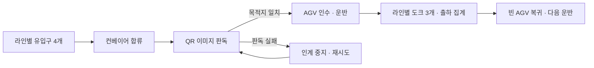

# SmartFactory — FLOW 공장 물류 시뮬레이션

한 공장 안의 선택한 1~4개 공정에서 상자가 컨베이어를 지나 QR 판독을 받고, AGV(자동 운반 차량)에 실려 목적지 도크까지 이동하는 과정을 보여주는 한국어 3D 웹앱입니다. 브라우저에서 물류 흐름을 관찰하는 시뮬레이션이며 실제 설비를 제어하지 않습니다.

- 앱 버전: **v0.0.20** — package.json과 화면 기준. 저장소 이름 `SmartFactory_v1.1.0`과 구분합니다.
- README 문서 버전: v0.0.21
- 최초 생성: 2026-11-02 (KST) / 수정: 2026-11-02 (KST)
- 기능 ID: `SW_Browser_Logistics_001` / 관련 기능 ID: 없음
- 지시자: 이종인 / 작업자: GPT-6 (Codex) — 문서 정리와 Git 반영 준비



기본 1공정이며 공정 수를 1~4개로 선택합니다. 네 공정 선택 시 위 흐름을 L1~L4에서 각각 실행합니다. **총 유입구 16개, QR 판독 지점 4개, 도크 12개, 탑차 모델 12개**입니다. 화면에서는 기존 레이어를 공정으로 부릅니다. 숨긴 공정은 실행과 집계에서 제외됩니다.

## 주요 기능

- 네 라인을 X=0, Z=0·29·58·87에 한 열로 배치하며 각 라인은 자체 상자·장비·출하 상태를 갖습니다.
- 공정당 AGV 1~12대를 동일 적용합니다. 기본값은 공정당 4대이며 기본 한 공정에서 전체 4대입니다. 공정 수 또는 AGV 대수 변경 시 전체 운반·통계를 초기화합니다.
- 라인별 3초마다 상자 생성을 시도합니다. 선택한 유입구가 막히면 해당 상자의 생성을 기다립니다.
- 컨베이어 0.5m/s, AGV 1.2m/s로 이동합니다. 1 unit=1m이며 실측 사양이 아닌 임시 운영값입니다.
- 합류 순서·상자 간격을 관리합니다. AGV는 이동 구간을 예약하고 겹치지 않는 구간에서 동시에 이동합니다. QR 판독 전 선배차, 옆 대기, 빈 장비의 QR 직행 복귀를 지원합니다.
- 운반 완료 수, 이송 중 상자, 목적지별 출하, 경과 시간, 전체 AGV 상태, 최근 판독 결과와 작업 기록을 표시합니다.

목적지는 다음과 같습니다.

- L1: 목동 · 합정동 · 면목동
- L2: 역삼동 · 잠실동 · 천호동
- L3: 화곡동 · 구로동 · 독산동
- L4: 상계동 · 창동 · 길음동

## 기술 환경

2026-11-02 KST에 로컬 버전 출력과 잠금 파일로 확인했습니다.

- Node.js **v24.18.0**, npm **11.16.0**
- JavaScript ES modules: 별도 언어 버전 고정 없음
- Vite **8.3.5**: 설치 패키지의 Node.js 요구 조건은 `^20.19.0 || >=22.12.0`
- Three.js **0.187.0**, qrcode **1.5.4**, jsqr **1.4.0**
- WebGL을 사용할 수 있는 브라우저와 그래픽 환경 필요

별도 API 키, 환경 변수, 백엔드, 데이터베이스 설정은 없습니다. 시뮬레이션 상태는 브라우저 메모리에 있으며 새로고침하면 초기화됩니다.

## 설치와 실행

Git과 위 요구 조건에 맞는 Node.js를 설치한 뒤, 원하는 작업 폴더의 터미널에서 실행합니다.

```powershell
git clone https://github.com/leejonin/SmartFactory_v1.1.0.git
cd SmartFactory_v1.1.0
npm ci
npm run dev
```

`npm ci`는 잠금 파일에 기록된 의존성을 설치합니다. 패키지를 내려받을 때 네트워크가 필요합니다. 터미널에 표시되는 Local 주소를 브라우저에서 엽니다. 개발 서버는 `127.0.0.1`에 연결되며 실제 포트는 터미널 출력을 따릅니다. HTML 파일을 직접 더블클릭하는 대신 Vite 서버를 사용합니다.

```powershell
# 자동 테스트
npm test
# 정적 배포 파일 생성
npm run build
# 빌드 결과 로컬 확인
npm run preview
```

빌드 결과는 저장소 안의 `dist/`에 생성됩니다. `preview`는 빌드 후 실행하는 로컬 확인용 서버입니다.

## GitHub Pages 배포

배포 주소: [SmartFactory 실행](https://leejonin.github.io/SmartFactory_v1.1.0/)

`.github/workflows/pages.yml`이 main 브랜치 push 또는 수동 실행을 받아 Node.js 24에서 `npm ci` → `npm test` → `npm run build`를 실행하고 `dist/`를 GitHub Pages에 배포합니다. 저장소 Settings → Pages의 Source는 GitHub Actions로 설정합니다. 배포 성공 여부는 저장소 Actions의 `GitHub Pages 배포` 실행 결과에서 확인합니다.

`vite.config.js`의 base는 `/SmartFactory_v1.1.0/`입니다. JavaScript·CSS와 GLB 주소 모두 이 하위 경로를 사용합니다. 로컬 dev·preview에서도 터미널에 표시되는 이 경로의 주소를 엽니다. 저장소 이름이나 배포 경로를 바꾸면 base와 위 링크를 함께 바꿔야 합니다.

## 화면 조작

1. 왼쪽 드래그로 화면을 끌어 이동하고(지도처럼 바닥을 따라 움직임), 휠로 확대·축소합니다. 오른쪽 드래그로 회전합니다. 터치는 한 손가락 이동, 두 손가락 확대·회전입니다. 공정 컨베이어를 짧게 클릭하면 그 공정의 컨베이어 상세 화면(conveyor.html)으로 넘어갑니다. 두 화면 상단 오른쪽의 `공장 전체 | 컨베이어 상세` 버튼으로도 언제든 오갈 수 있으며, 상세 화면은 마지막으로 본 공정으로 열립니다.
2. 탑뷰는 공장 전체를 위에서 봅니다. QR 뷰와 AGV 뷰는 L1 주변의 고정 시점이며 개별 장비 추적 기능은 아닙니다.
3. 일시정지/재생, 초기화, 1·2·5배속을 선택합니다.
4. 공정당 AGV 대수 변경은 네 라인에 동시에 적용되고 운반·통계를 초기화합니다.
5. QR 판독 실패 상자가 있으면 `QR 다시 읽기` 버튼이 표시됩니다.

## QR 판독과 운반 방식

`qrcode`가 목적지를 담은 JSON을 QR 픽셀 이미지로 만들고 `jsQR`이 그 RGBA 이미지를 읽습니다. 판독 목적지가 해당 라인의 허용 목록에 있고 상자 목적지와 일치해야 인계합니다. 실패하면 상자를 멈추며 원래 목적지 값으로 우회하지 않습니다. 카메라 영상이나 원근이 있는 3D 화면을 판독하는 방식은 아닙니다.

상자는 컨베이어 이동 → QR 판독 → AGV 대기 → 인수 → 도크 운반 → 인도 순서로 처리합니다. 인수와 인도는 각각 2초입니다. 도크 인도 후 출하 수를 올리고 상자를 장면에서 제거합니다. 트럭 내부 적재나 트럭 출발은 구현하지 않았습니다.

## 소스 구조와 설정

아래 경로는 복제한 저장소의 최상위 폴더를 기준으로 합니다.

- `index.html`: 앱 진입 HTML.
- `src/main.js`: 화면, 버튼 이벤트, 1/60초 고정 단계 실행과 통계 갱신.
- `src/layout.js`: L1~L4 위치와 목적지 설정.
- `src/factory.js`: 네 Simulation 생성, 실행·초기화·AGV 설정 전달, 전체 통계 취합.
- `src/simulation.js`: 상자 생성·합류·판독 상태·배차·이동 예약·도크 집계. AGV_SPEED, GAP, INLETS, DOCKS 정의.
- `src/qr.js`: encodeRegion 이미지 생성, decodeRegion 판독·허용 목적지 검사.
- `src/scene.js`: Three.js 장면·카메라·GLB 로드·상태 화면 반영. 장비 로드 실패 시 기본 형상 사용.
- `src/style.css`: 화면 스타일.
- `tests`: 단일 라인 및 네 라인 자동 검사.
- `Asset`: 컨베이어 2종·AGV·탑차 GLB 원본 4개. `Asset/aws-warehouse`: 선반·고층 랙·팔레트·핸드파렛트·작업대·수거함 GLB 8개와 콘크리트 바닥 텍스처(MIT-0, 출처는 폴더 안 LICENSE.txt).
- `Info`: 기능 설명·개념·기술 환경·계획·작업 이력·문제 목록.
- `package.json`: 실행 명령과 의존성 버전. package-lock.json은 같은 폴더에 있는 설치 버전 잠금 파일입니다.

호출 흐름은 main.js → FactorySimulation.step(dt) → 각 Simulation.step(dt) → 장면 sync·render입니다. 다음은 main.js의 실제 프레임 루프 발췌입니다.

```javascript
if(!paused&&!document.hidden){accumulator+=dt*speed;while(accumulator>=1/60){sim.step(1/60);accumulator-=1/60;}}
```

누적 시간을 작은 단위로 나누어 렌더 횟수와 시뮬레이션 단계를 구분합니다. 비활성 탭 복귀 시 누적 시간을 비워 갑작스러운 이동을 막습니다. 라인 수·도크 수·AGV 최대 대수에는 고정된 화면·로직 전제가 있으므로 설정 하나만으로 임의 규모 확장을 보장하지 않습니다.

## 에셋과 Git 포함 범위

GLB 4개의 내부 asset.copyright에서 **Innerscene Corp / CC0 1.0 Universal** 표시를 확인했습니다. `Asset/aws-warehouse`의 현장 소품은 [aws-robomaker-small-warehouse-world](https://github.com/aws-robotics/aws-robomaker-small-warehouse-world)(MIT-0)의 DAE를 GLB로 변환한 것입니다. 장면 생성 시 AGV 선반·보관 상자 및 컨베이어의 정적 상자 일부를 제외하지만 원본 파일은 보존합니다. 이 표시는 앱 소스 전체의 라이선스를 뜻하지 않으며 별도의 소스 LICENSE 파일은 없습니다.

Git에 포함하는 파일은 소스·테스트·HTML·패키지 설정과 잠금 파일·GLB 원본·README·Info 문서와 기존 검증 이미지입니다. 기존 .gitignore에 따라 node_modules, dist, .vite는 제외합니다. 의존성과 빌드는 실행 명령으로 다시 만들 수 있습니다. GLB 원본 합계는 약 32MB입니다.

## 검증과 제한

2026-11-02 KST, 기존 설치 의존성으로 다시 실행했습니다.

- **npm test: 13개 통과, 실패 0개.** 실제 QR 픽셀 판독, 실패·잘못된 목적지 처리, 초기화, 1~3대 AGV 반복 운행, 여러 난수 시나리오, 네 라인 독립성과 물량 보존을 검사했습니다.
- 네 라인 10분 고정 시드 도크별 인도: `[5,13,14,9,15,9,14,8,8,7,9,15]`. 충돌 검사는 테스트의 좌표·간격·표본 시점 기준이며 물리 엔진이나 현장 안전 검증이 아닙니다.
- **npm run build: 통과.** JavaScript 819.55kB, gzip 224.43kB. 500kB 초과 청크 경고는 남아 있습니다(`SW_Browser_Logistics_Unresolved_001`).
- 이번 문서 작업에서 브라우저 화면 재실행과 깨끗한 환경의 npm ci는 미확인입니다(`SW_Browser_Logistics_Unverified_005`). 기존 v0.0.10 화면 검증 이력은 보존했습니다.
- 실제 외형 적합성(`SW_Browser_Logistics_Unverified_001`), 원스케치 비교(`SW_Browser_Logistics_Unverified_002`), 저사양 GPU·여러 브라우저·터치 환경(`SW_Browser_Logistics_Unverified_003`)은 미확인입니다.

실제 설비 연결, 충돌 물리 엔진, 실측 처리량 보장, 영구 저장은 현재 범위에 없습니다. AGV 대수에 비례하는 처리량 증가도 보장하지 않습니다.

상세 문서: [물류시뮬레이션.md](Info/소프트웨어/물류시뮬레이션/SW_Browser_Logistics_001/물류시뮬레이션.md)

문제 현황: [문제_목록.md](Info/소프트웨어/물류시뮬레이션/SW_Browser_Logistics_001/problem/문제_목록.md)

이번 변경은 누적 설명 형태의 README를 현재 4라인 구현·설치·구조·검증 범위 중심으로 정리한 것입니다. 앱 코드·패키지 버전·기존 작업 이력은 변경하지 않았습니다.


## v0.0.13 AGV 개선

복귀 경로 단축, 예상 도착 시간 기준 배차, 도크별 1대 대기 공간 확보 후 선픽업, 통과 구간 해제와 회전 출구 예약을 적용했습니다. 도크가 비면 대기장 우회 없이 직행합니다. 컨베이어 로직은 유지합니다. 같은 다섯 난수 조건의 30분 시험에서 AGV 3대 평균 출하는 96.8개에서 125.8개로 늘었으며, 대기열 완전 해소는 아닙니다. 테스트 20개가 통과했습니다.


### v0.0.15 AGV 경로와 픽업 대기 개선

위쪽 도크행 경로를 분리하고 도크 본자리 확보 시 대기면 중복 예약을 해제했다. 컨베이어·생성·QR·이송 중 집계는 유지한다. 기본4대의5조건30분 평균 출하148.4→166.4개, 최대이송중28~30개로 **20개 이하 유지 목표는 미달성**이다. 테스트22개 및 빌드 통과. 재현: `node scripts/benchmark-agv.mjs`.


### v0.0.16 유입 합류 정지 수정

막힌04 합류 요청 때문에 빈02·03까지 멈추던 전역 대기 문제를 수정했다. 진행 중 예약을 유지하며 진입 가능한 티켓부터 합류한다. 생성 주기·이동 속도·QR은 유지했다. 재현 회귀시험 포함24개와 빌드 통과.


문서 본문의 일반 파일 경로는 저장소 루트 기준 상대 경로입니다. Markdown 링크는 해당 문서 위치를 기준으로 합니다. `../AiInfo/`는 저장소 외부의 로컬 공통 지침이며 저장소에 포함되지 않습니다.


### v0.0.17 현업형 장면 에셋

격자 바닥과 대형 글자 벽을 콘크리트 바닥, 패널 외벽, H형강 기둥으로 바꿨습니다. 카메라 쪽 벽은 1.1m 단면으로 잘라 내부가 보입니다. 출하 도크에는 도크 레벨러·범퍼·셸터·볼라드를 넣었고, 탑차는 건물 밖 아스팔트 진입로에서 후진 접안한 위치로 옮겼습니다. 유입구 문틀은 입고 팔레트로 바꿨고, 선반·고층 랙·핸드파렛트·작업대 등 AWS 창고 에셋 8종을 AGV 경로 밖에 배치했습니다. 운영 로직은 바꾸지 않았으며 테스트 24개가 통과했습니다. 그리기 호출은 4공정 기준 +2.4%입니다. 이번 작업 환경에서 `npm run build`는 실행하지 못했습니다(`SW_Browser_Logistics_Unverified_009`).

### v0.0.19 공정 컨베이어 상세 화면

공장 화면에서 공정 컨베이어를 클릭하면 `conveyor.html?line=L1~L4` 상세 화면이 열립니다. 공두이노 DIY 컨베이어 색상 분류 키트를 실물 크기로 재현했습니다. 주황 3D 프린팅 프레임, 2020 알루미늄 프로파일, 녹색 벨트, 원통형 근접센서, 컬러센서, SG90 서보 분류 팔(노랑·초록), 아크릴 상자 3개, 아크릴 받침 위 아두이노 UNO, 전선이 들어 있습니다. 블록이 투입→감지→판독→게이트→색별 상자 순서로 움직입니다. 보드·서보·센서·베어링·프로파일은 [FreeCAD-library](https://github.com/FreeCAD/FreeCAD-library)(CC-BY 3.0)의 실측 STEP 모델을 GLB로 변환해 썼습니다(`Asset/kit-parts/LICENSE.txt`). 기능 ID는 `SW_Browser_ConveyorKit_001`이며 테스트는 27개 통과입니다. `npm run build`는 이번 작업 환경에서 실행하지 못했습니다.
